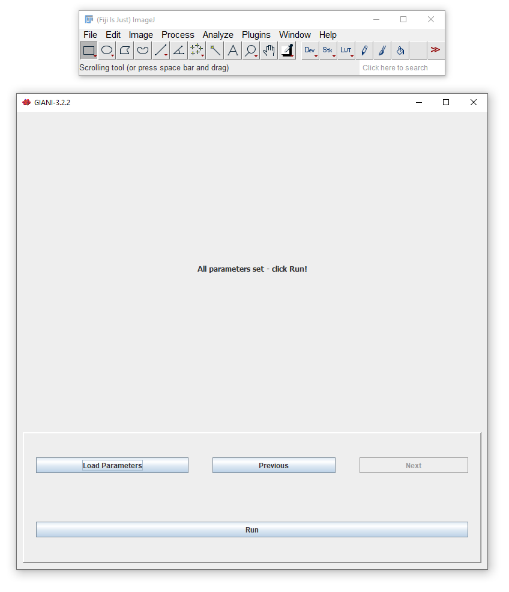

*****************************
Running the Complete Analysis
*****************************

.. TODO(screenshot): recapture GIANI_Run_Panel.PNG with the current wizard.

When you are happy with your parameters, click *Run* to have GIANI analyse
all of the images in the input directory you have specified. Progress is
reported in the FIJI *Log* window.

Output folder
=============

When the analysis is complete, you will find a new folder in the input
directory named ``GIANI-X.Y.Z_Output``, where ``X.Y.Z`` is the version of
GIANI used for the analysis. If that folder already exists, a numbered
suffix is added (``GIANI-X.Y.Z_Output_(1)``, etc.), so earlier results are
never overwritten. It contains:

* **GIANI-X.Y.Z_Output.csv** - all measurement data, one row per nucleus,
  cell and cytoplasm (see :doc:`../measure/specifying_channels` for the
  measurements). Rows belonging to the same cell share a ``Cell_Index``, and
  the ``Series`` and ``Time`` columns identify which image series and
  timepoint each row came from. This file can be opened directly in
  Microsoft Excel, or imported into MATLAB, R, Python, Prism, or any other
  data analysis software.
* **Mask folders** - one folder per object type for each data set analysed
  (e.g. ``<image>-S0_Nucleus_masks``, ``<image>-S0_Cell_masks``,
  ``<image>-S0_Cytoplasm_masks``, and per-channel ``Spot_masks`` if
  :doc:`spot localisation <../measure/localising_spots>` was enabled). Each
  mask is saved as a series of PNG images, one per Z-slice and timepoint,
  named ``..._T<timepoint>_Z<slice>.png``. In each mask, every object is
  labelled with its own pixel value.
* **spot_summary_data.csv** - a per-cell summary of detected spots, if spot
  localisation was enabled.
* **properties.xml** - all of the parameters that were used for the
  analysis. This can be viewed in any text editor, or loaded back into GIANI
  with the *Load Parameters* button to repeat the same analysis on a
  different data set. It is also the parameter file used to
  :doc:`run GIANI headlessly <../cluster/index>`.

If :doc:`lineage tracking <../start/tracking>` was enabled, the folder also
contains ``GIANI_tracks.csv``, ``*_track_masks`` folders, and a ``Track ID``
column in the CSV files - see :ref:`tracking output <tracking-output>`.
