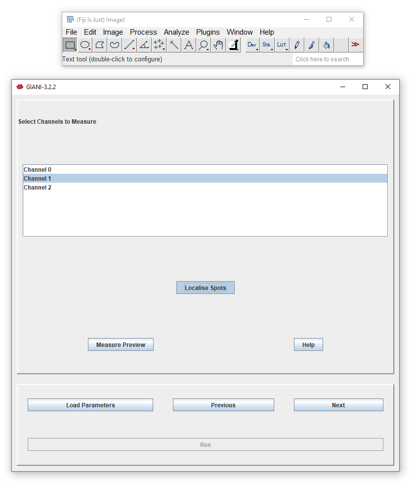
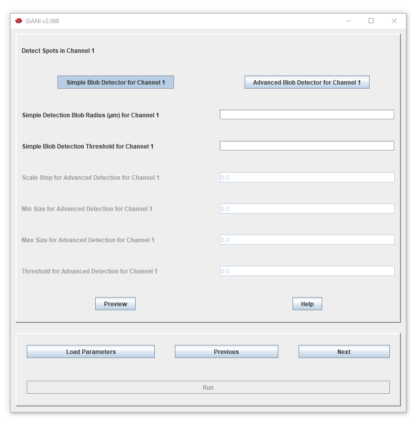
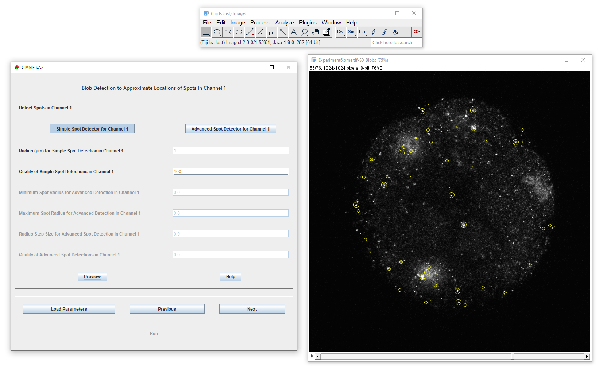

Localising Spots
****************

If you selected *Localise Spots* when :doc:`specifying channels to measure <specifying_channels>`, GIANI will also detect spots in each of the selected channels and relate them to the cells that contain them. A per-cell summary of the spots is saved to ``spot_summary_data.csv`` in the :doc:`output folder <../complete/index>`.

To adjust how spots are detected, enable *Show Advanced Options* (see :doc:`../start/index`). After clicking *Next*, you will then be presented with options dictating how those spots should be detected:

.. note:: With *Advanced Options* hidden, the spot detection panels are not shown and spots are detected using default settings.

It is possible to specify different options for each channel - you will be presented with a different parameter panel for each of the channels that you selected when specifying channels to measure. The functionality is exactly the same as that previously described for :doc:`estimating the centres of nuclei <../nuclei/estimate_centroids>`.

Clicking *Preview* will show you what spots have been detected in the current channel.

