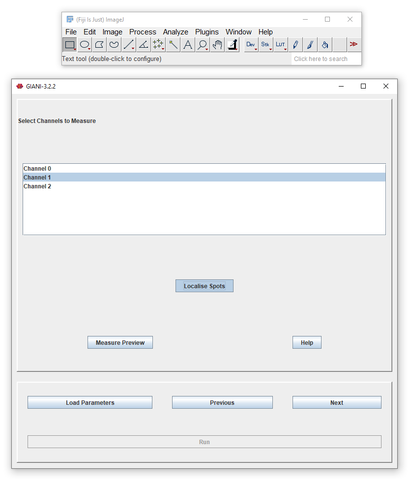
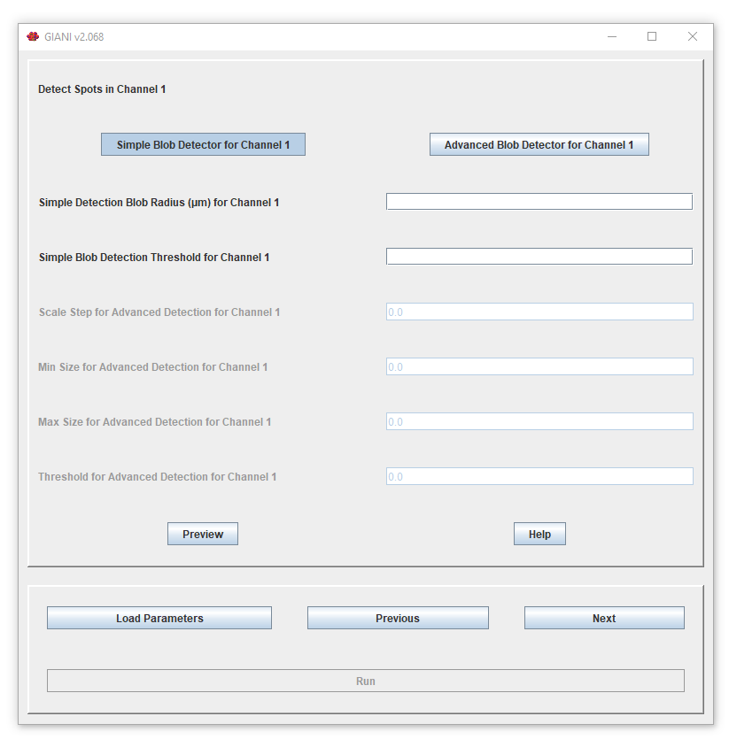
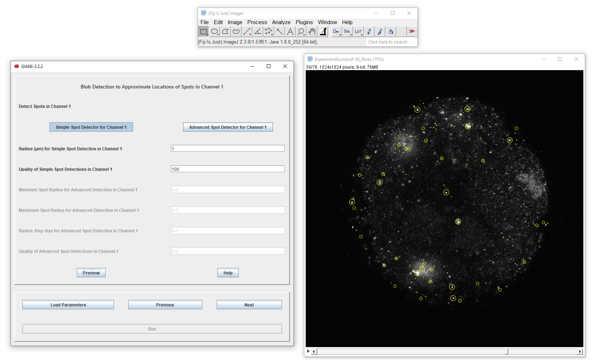

Localising Spots
****************

If you selected *Localise Spots* when :doc:`specifying channels to measure <specifying_channels>`, GIANI will also detect spots in each of the selected channels and relate them to the cells that contain them. A per-cell summary of the spots is saved to ``spot_summary_data.csv`` in the :doc:`output folder <../complete/index>`.

After clicking *Next*, you will be presented with options dictating how those spots should be detected. These panels are always shown when *Localise Spots* is selected, whether or not *Show Advanced Options* is on (see :doc:`../start/index`), because the right settings depend on your images and you should check them before running:

It is possible to specify different options for each channel - you will be presented with a different parameter panel for each of the channels that you selected when specifying channels to measure. The functionality is exactly the same as that previously described for :doc:`estimating the centres of nuclei <../nuclei/estimate_centroids>`.

Clicking *Preview* will show you what spots have been detected in the current channel.

Spot radius
===========

The default (*simple*) detection method needs the approximate radius of your spots, in calibrated units (for example microns). It starts at ``0.5`` and should be adjusted to match your spots; use *Preview* to check the result. The radius must be **greater than 0**: a radius of 0 makes every voxel in the image count as a spot, so the results would be meaningless.

GIANI therefore refuses to run if a selected channel uses the simple detector with a radius of 0 or less (or one that is blank or not a number). In the wizard a message names the channel; on the :doc:`command line <../cluster/index>` the error is logged and GIANI exits with status ``1``. This also catches ``properties.xml`` files saved by older versions of GIANI, which could store a radius of ``0.0``: load the file in the wizard with *Load Parameters* and set a radius on that channel's spot panel, or edit the value in the file. The other detection methods (advanced, StarDist, ilastik and grey-level thresholding) do not use this radius, so it never stops a run that uses one of them.
