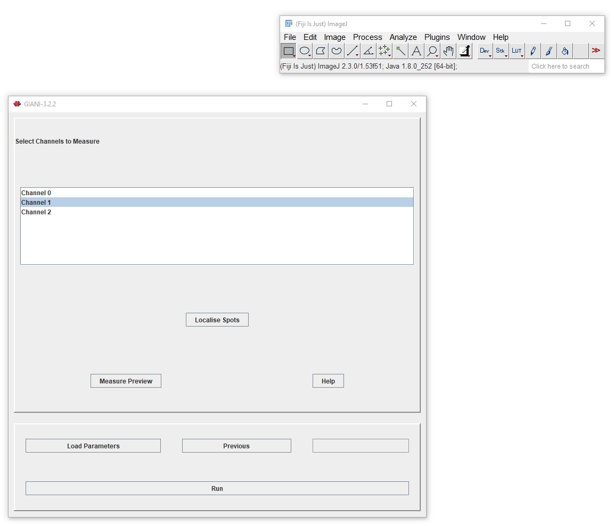
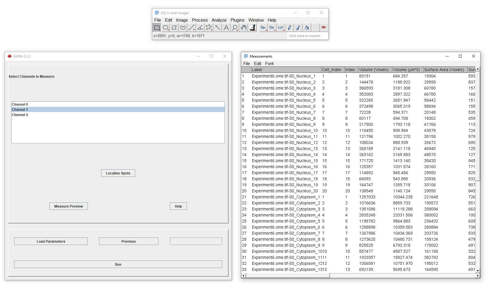

Specifying Channels to Measure
******************************

This panel allows you to choose which channels to measure, and to preview measurements based on the segmentation of nuclei and cells. For each channel you select here, GIANI will make various intensity measurements within the nucleus, cytoplasm and entire body of each segmented cell:

* Mean pixel intensity
* Standard deviation of pixel intensities
* Minimum pixel value
* Maximum pixel value
* Integrated density

The following morphological and positional measurements are also output for each nucleus, cell and cytoplasm:

* Volume (in voxels and in calibrated units, e.g. µm³)
* Surface area (in voxels and in calibrated units, e.g. µm²)
* Centroid (X, Y and Z)
* Normalised distance to centre

Each row also records the ``Series`` and ``Time`` (timepoint) it came from, and a ``Cell_Index`` shared by the nucleus, cell and cytoplasm of the same cell.

Clicking *Preview* will display a results table containing all of the above measurements for each region of each cell in each of the channels selected.

At this point, you have specified enough parameters to run a complete analysis on all images in your input directory. Alternatively, clicking *Localise Spots* makes available additional options to :doc:`localise spots <localising_spots>`.
