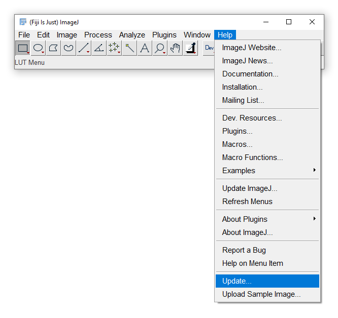
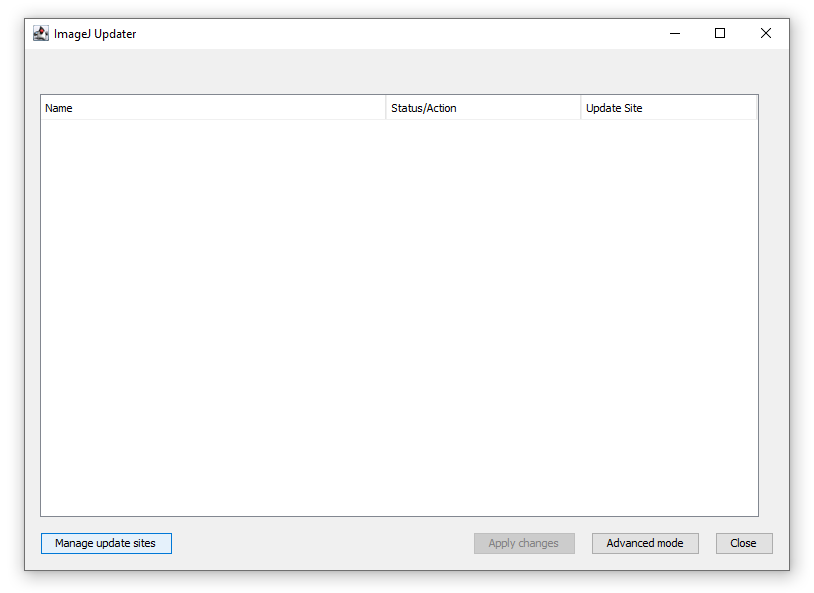
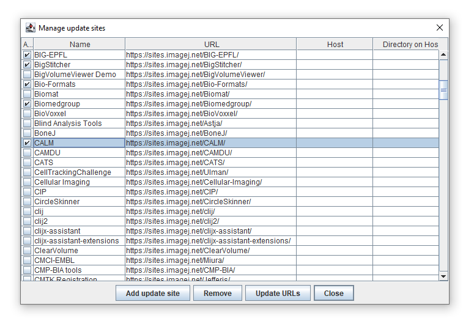
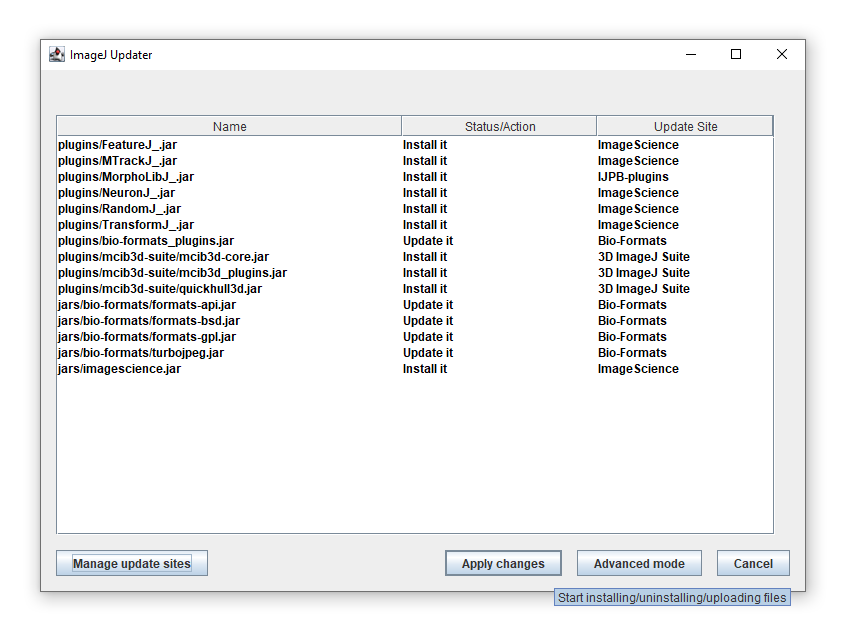
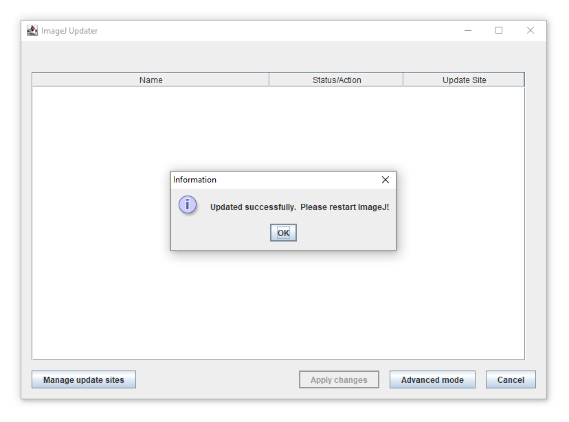

****************
Installing GIANI
****************

The easiest way to get the latest version of GIANI is from within FIJI.
The following is a step-by-step guide to enabling the relevant update
sites. You only need to perform this procedure once - it will ensure you
always have the most up-to-date version of GIANI and its dependencies.

.. note:: GIANI is distributed via the **CALM** update site. Older versions
   of that site also shipped a suite of other tools (BALM, FRAP, particle
   analysis, etc.) that have now been retired - only GIANI and its support
   library remain. If you are upgrading from an old installation, see
   `Upgrading from an older version`_ below.

Step 1 - Run the FIJI Updater
~~~~~~~~~~~~~~~~~~~~~~~~~~~~~

From FIJI’s *Help* menu, click *Update…*

|image1|

Step 2 - Open the Manage Update Sites dialog
~~~~~~~~~~~~~~~~~~~~~~~~~~~~~~~~~~~~~~~~~~~~

When the *ImageJ Updater* opens, click *Manage update sites*

|image2|

Step 3 - Select the relevant update sites
~~~~~~~~~~~~~~~~~~~~~~~~~~~~~~~~~~~~~~~~~

When the *Manage update sites* window opens, make sure that each of the
following update sites has a tick next to it:

* CALM
* 3D ImageJ Suite
* IJPB-plugins
* ImageScience

|image3|

When all the sites have been ticked, click *Close*.

.. TODO(screenshot): recapture Add_Sites.png with the current list of sites ticked.

Step 4 - Apply Changes
~~~~~~~~~~~~~~~~~~~~~~

You’ll now return to the ImageJ Updater window, which will be populated
with a list of files that FIJI needs to download. Click *Apply changes*
to begin the download process.

|image4|

Step 5 - Restart FIJI
~~~~~~~~~~~~~~~~~~~~~

If all has gone well, you will be prompted to restart FIJI to complete
the installation process. GIANI will then appear directly on FIJI's
*Plugins* menu.

|image5|

Upgrading from an older version
~~~~~~~~~~~~~~~~~~~~~~~~~~~~~~~

GIANI 3.x requires Java 21, which is bundled with current releases of FIJI.
If you are upgrading an old FIJI installation, it is simplest to start from a
fresh download of FIJI. If you upgrade in place, make sure that no old copies
of ``calm-*.jar``, ``giani-*.jar`` or ``IAClassLibrary-*.jar`` /
``iaclasslibrary-*.jar`` remain in FIJI's ``plugins`` or ``jars`` folders
other than the ones installed by the updater.

--------------

