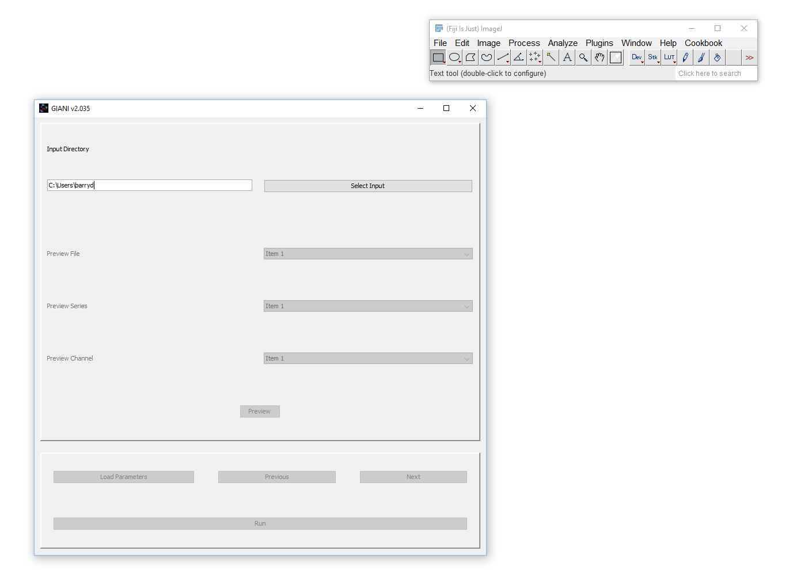
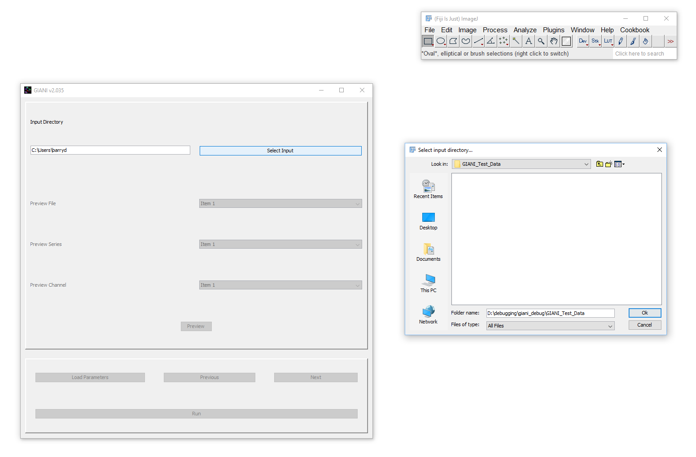

*********************
Selecting Input Files
*********************

When you run GIANI, the first thing you’re presented with is a panel requesting the location of the input directory:

   GIANI Select Input Directory

.. TODO(screenshot): recapture GIANI_Select_Input.PNG with the current wizard
   (title bar shows the GIANI version; button bar includes Show Advanced Options).

Clicking on *Select Input* will bring up a standard folder selection dialog - use this to specify the directory containing the images you wish to analyse. Every image in that directory will be analysed when you click *Run*.

   GIANI Select Input Dialog

If the text denoting your input directory is highlighted in red, this indicates that an invalid input directory has been specified. GIANI also checks the input when you click *Run*, and shows an error if the directory does not exist or contains no image files that Bio-Formats can read.

.. note:: To analyse a single image file rather than a whole directory, use :doc:`headless mode <../cluster/index>`.
